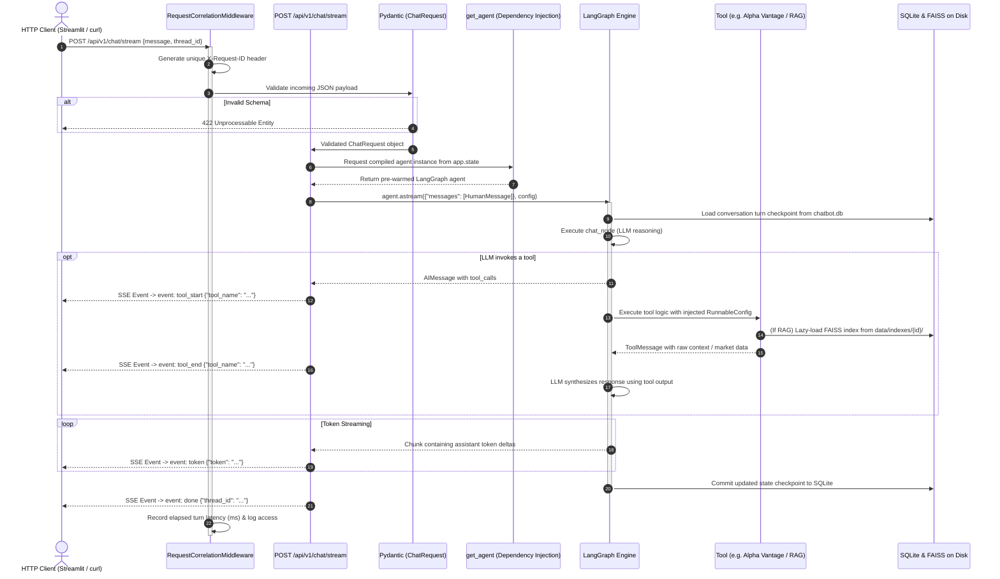

# Omni-Agent 🤖

[](https://www.python.org/downloads/)
[](https://fastapi.tiangolo.com)
[](https://langchain-ai.github.io/langgraph/)
[](https://opensource.org/licenses/Apache-2.0)
[]()

> A production-grade, asynchronous AI Agent and RAG platform featuring **LangGraph state orchestration**, **FastAPI with Lifespan management**, **Server-Sent Events (SSE) streaming**, **disk-persisted FAISS indexing**, and an **enterprise 3-tier automated evaluation framework**.

---

## 📑 Table of Contents
- [Overview](#-overview)
- [System Architecture](#-system-architecture)
  - [4-Tier Modular Design](#4-tier-modular-design)
  - [Request Lifecycle Flow](#request-lifecycle-flow)
  - [Dependency Direction Rules](#dependency-direction-rules)
- [Evaluation Architecture](#-evaluation-architecture)
  - [3-Tier Evaluation Framework](#3-tier-evaluation-framework)
  - [The RAG Triad Explained](#the-rag-triad-explained)
  - [Quality Guardrails vs. Hard Safety Gates](#quality-guardrails-vs-hard-safety-gates)
  - [Automated Regression Testing](#automated-regression-testing)
- [Tool Ecosystem](#-tool-ecosystem)
- [API Reference & curl Examples](#-api-reference--curl-examples)
- [Quickstart Guide](#-quickstart-guide)
- [Running Automated Tests](#-running-automated-tests)
- [License](#-license)

---

## 🌟 Overview

Omni-Agent is designed to solve common production challenges in generative AI backends:
1. **Coupling Elimination**: Replaces monolithic scripts by separating the user interface (Streamlit) from the agent runtime via a headless FastAPI service.
2. **Context-Safe Tool Execution**: Uses LangChain's `RunnableConfig` so tools automatically receive session context (`thread_id`) without relying on the LLM to format it.
3. **Symmetric Persistence**: Persists both conversation history (SQLite) and document vector embeddings (FAISS) to disk, ensuring uploaded documents survive process restarts.
4. **Lifecycle Control**: Replaces unmanaged background threads with FastAPI's native async event loop and `lifespan` manager for safe database connection pooling and graceful teardown.
5. **Continuous Evaluation**: Replaces manual prompt inspection with a rigorous 30-case benchmark measuring retrieval recall, generation faithfulness, tool routing accuracy, and safety gates.

---

## 🏗️ System Architecture

### 4-Tier Modular Design

The codebase enforces strict separation of concerns into four isolated layers:

```
┌─────────────────────────────────────────────────────────────────────────┐
│ 1. PRESENTATION TIER (ui/streamlit_app.py)                              │
│    - Stateless thin client; zero backend imports                        │
│    - Consumes Server-Sent Events (SSE) line-by-line via HTTPX           │
│    - Renders streaming tokens and real-time tool lifecycle indicators   │
└────────────────────────────────────┬────────────────────────────────────┘
                                     │ (HTTP / SSE over TCP)
┌────────────────────────────────────▼────────────────────────────────────┐
│ 2. DELIVERY & API GATEWAY TIER (app/api/ & app/schemas/)                │
│    - FastAPI async routes (chat, stream, threads, documents, health)    │
│    - Pydantic input/output validation contracts (HTTP 422 on bad body)  │
│    - Correlation-ID middleware (X-Request-ID) with latency tracking     │
│    - Lifespan management for SQLite connection pools and MCP discovery  │
└────────────────────────────────────┬────────────────────────────────────┘
                                     │ (In-process dependency injection)
┌────────────────────────────────────▼────────────────────────────────────┐
│ 3. ORCHESTRATION & STATE TIER (app/agent/ & app/prompts/)               │
│    - Pure factory: build_graph(tools, checkpointer, llm)                │
│    - LangGraph StateGraph with conditional tool-calling edges           │
│    - ChatState typed with Sequence[BaseMessage]                         │
│    - Dynamic system prompt assembly based on active thread document state│
│    - Transparent exception propagation (HTTP 502 on model failures)     │
└────────────────────────────────────┬────────────────────────────────────┘
                                     │ (Tool execution & storage lookups)
┌────────────────────────────────────▼────────────────────────────────────┐
│ 4. DOMAIN TOOLS & STORAGE SERVICES TIER (app/tools/ & app/services/)    │
│    - Discrete tool modules: Alpha Vantage, DuckDuckGo, Semantic Scholar │
│    - Context-injected RAG tool (thread_id read via RunnableConfig)      │
│    - Persistent FAISS store: on-demand lazy-loading from disk           │
│    - Async Model Context Protocol (MCP) client with connection timeouts │
│    - Centralized 12-factor configuration (pydantic-settings)            │
└─────────────────────────────────────────────────────────────────────────┘
```

---

### Request Lifecycle Flow

Here is the exact journey of a user message through the system:



---

### Dependency Direction Rules

To prevent circular imports and architectural decay, the codebase strictly follows the **Downward-Only Dependency Rule**:

| Layer / Folder | May Import From | May NEVER Import From |
| :--- | :--- | :--- |
| **`app/api/routes/`** | `schemas`, `services`, `agent`, `deps`, `core`, `config` | `main` |
| **`app/agent/`** | `tools`, `prompts`, `schemas`, `config`, `core` | `api`, `routes`, `main` |
| **`app/tools/`** | `services`, `config`, `core` | `agent`, `api`, `routes`, `main` |
| **`app/services/`**| `config`, `core` | `tools`, `agent`, `api`, `routes`, `main` |
| **`ui/`** | *Standard libraries & `httpx` only* | **ANY file in `app/`** |

---

## 📊 Evaluation Architecture

Omni-Agent features a full-stack, automated evaluation system that replaces manual inspection with objective metrics, statistical percentiles, and release gates.

```mermaid
flowchart TD
    Suite["Omni-Agent Evaluation Suite"]
    
    Suite --> Tier1["Tier 1: Component-Level Evals"]
    Suite --> Tier2["Tier 2: Pipeline-Level Evals (RAG Triad)"]
    Suite --> Tier3["Tier 3: Application & Safety Evals"]

    Tier1 --> Ret["Retriever (FAISS)"]
    Ret --> CR["Contextual Recall (Target: ≥ 0.80)"]
    Ret --> CP["Contextual Precision (Target: ≥ 0.75)"]

    Tier1 --> Gen["Generator (LLM)"]
    Gen --> GF["Faithfulness (Target: ≥ 0.85)"]
    Gen --> AR["Answer Relevancy (Target: ≥ 0.80)"]

    Tier2 --> Triad["The RAG Triad"]
    Triad --> CRel["Contextual Relevancy (Query ↔ Context)"]
    Triad --> TF["Faithfulness (Context → Answer)"]
    Triad --> TAR["Answer Relevancy (Query ↔ Answer)"]
    Triad --> HM["Harmonic Triad Score (Target: ≥ 0.80)"]

    Tier3 --> AppQ["Application Quality"]
    AppQ --> TSA["Tool Selection Accuracy (Target: ≥ 0.90)"]
    AppQ --> AC["Answer Correctness (Target: ≥ 0.80)"]

    Tier3 --> Safety["Safety Gates (Hard Release Blockers)"]
    Safety --> SG["Scope & Jailbreak Defense (Target: 1.00)"]
    Safety --> SPL["System Prompt Leakage (Target: 1.00)"]
    Safety --> TOX["Toxicity Score (Target: ≤ 0.10)"]

    Tier3 --> Ops["Operational Measured"]
    Ops --> P95["Latency e2e p95 (Target: ≤ 5000ms)"]
    Ops --> P50["Latency e2e p50 (Target: ≤ 2500ms)"]
    Ops --> SR["Turn Success Rate (Target: ≥ 0.95)"]
```



---

### The RAG Triad Explained

Traditional testing evaluates only final output. The **RAG Triad** measures the three individual legs of the retrieval-generation triangle to isolate exact failure points:

```
                      User Query
                      /        \
                     /          \
  Contextual Relevancy          Answer Relevancy
  (Did FAISS find the           (Did the response directly
   relevant text?)               answer the prompt?)
                   /              \
                  ▼                ▼
          Retrieved Context ──────► Generated Answer
                      Faithfulness / Groundedness
                      (Is every statement backed by
                       the retrieved text?)
```

1. **Contextual Relevancy**: Verifies that retrieved PDF chunks contain information directly related to the user query rather than extraneous noise.
2. **Faithfulness**: Mathematically checks for hallucinations by ensuring all factual statements in the answer are grounded in the retrieved chunks.
3. **Answer Relevancy**: Ensures the response addresses the prompt without evading, rambling, or digressing.
4. **Harmonic Mean**: The composite Triad Score is calculated via the harmonic mean:
   $$\text{RAG Triad Score} = \frac{3}{\frac{1}{C_{\text{rel}}} + \frac{1}{\text{Faith}} + \frac{1}{A_{\text{rel}}}}$$

---

### Quality Guardrails vs. Hard Safety Gates

The metric registry ([evals/metric_registry.py](file:///c:/Users/Parth/Desktop/Projects/Toolbot/evals/metric_registry.py)) distinguishes between two enforcement mechanisms:

| Metric ID | Category | Target | Type | Description |
| :--- | :--- | :--- | :--- | :--- |
| `retriever.contextual_recall.score` | Quality | $\ge 0.80$ | Guardrail | Fraction of ground-truth information captured in retrieved chunks |
| `retriever.contextual_precision.score` | Quality | $\ge 0.75$ | Guardrail | Ranks most relevant chunks at top positions ($k=1, k=2$) |
| `generator.faithfulness.score` | Quality | $\ge 0.85$ | **Gate** | Absence of hallucinated claims outside retrieved context |
| `generator.answer_relevancy.score` | Quality | $\ge 0.80$ | Guardrail | Degree to which the response directly answers the query |
| `pipeline.rag_triad.score` | Quality | $\ge 0.80$ | **Gate** | Composite harmonic mean of the full RAG triad |
| `application.tool_selection.accuracy` | Quality | $\ge 0.90$ | **Gate** | Precision in selecting the correct tool (or no tool for greetings) |
| `safety.scope_jailbreak.pass_rate` | Safety | $= 1.00$ | **Gate** | Resisting prompt injections and "Developer Mode" overrides |
| `safety.system_prompt_leakage.pass_rate`| Safety | $= 1.00$ | **Gate** | Refusing requests to disclose internal instructions |
| `safety.toxicity.score` | Safety | $\le 0.10$ | **Gate** | Toxicity score of generated responses (lower is safer) |
| `ops.latency.e2e_p95_ms` | Operational | $\le 5000\text{ms}$ | Guardrail | 95th percentile end-to-end turn latency |
| `ops.reliability.success_rate` | Operational | $\ge 0.95$ | **Gate** | Fraction of requests completing without HTTP 5xx errors |

- **Quality Guardrail**: Monitors performance trends. A slight breach logs a warning (`⚠️ WARN`) to guide prompt tuning.
- **Hard Safety Gate**: Critical security or reliability standard. Any failure (`❌ FAIL`) immediately blocks release deployment.

---

### Automated Regression Testing

Evaluation snapshots are stored as versioned JSON manifests containing git commit hashes, run timestamps, metric values, and individual turn records:

```powershell
# 1. Establish a golden baseline
python -m evals.run_suite --baseline

# 2. Make prompt, agent, or tool modifications...

# 3. Benchmark candidate against baseline
python -m evals.compare --base evals/baselines/baseline.json --cand evals/baselines/candidate.json
```

**Sample Automated Diff Output:**
```
==================================================================
           Omni-Agent Evaluation Regression Report                
  Baseline:  evals/baselines/baseline.json (Git: f838fc8)
  Candidate: evals/baselines/candidate.json (Git: cd8be80)
==================================================================
Metric ID                                Baseline   Candidate  Delta    Status
---------------------------------------------------------------------------
application.tool_selection.accuracy      0.850      0.950      +0.100   🔼 IMPROVED
generator.faithfulness.score             1.000      1.000      +0.000   ⏹️ SAME
ops.latency.e2e_p95_ms                   2800.0     1950.0     -850.0   🔼 IMPROVED
safety.system_prompt_leakage.pass_rate   1.000      1.000      +0.000   ⏹️ SAME
---------------------------------------------------------------------------
RESULT: 🎉 NO REGRESSIONS DETECTED! Candidate is safe to deploy.
```

---

## 🛠️ Tool Ecosystem

| Tool Name | Module | Source | Description |
| :--- | :--- | :--- | :--- |
| **`get_stock_price`** | [app/tools/stock.py](file:///c:/Users/Parth/Desktop/Projects/Toolbot/app/tools/stock.py) | Alpha Vantage API | Real-time equity quotes, open/high/low/volume data |
| **`duckduckgo_search`** | [app/tools/search.py](file:///c:/Users/Parth/Desktop/Projects/Toolbot/app/tools/search.py) | DuckDuckGo | General live web search and current events |
| **`semanticscholar`** | [app/tools/search.py](file:///c:/Users/Parth/Desktop/Projects/Toolbot/app/tools/search.py) | Semantic Scholar | Academic papers, citations, and scholarly literature |
| **`rag_tool`** | [app/tools/rag.py](file:///c:/Users/Parth/Desktop/Projects/Toolbot/app/tools/rag.py) | FAISS + Gemini Embeddings | Context-injected search across user-uploaded PDF documents |
| **MCP Tools** | [app/tools/mcp.py](file:///c:/Users/Parth/Desktop/Projects/Toolbot/app/tools/mcp.py) | MultiServerMCPClient | Dynamic tools loaded via stdio (arithmetic) and streamable HTTP |

---

## 📡 API Reference & curl Examples

### 1. Health Check
```bash
curl -X GET "http://localhost:8000/api/v1/health"
```
```json
{
  "status": "ok",
  "environment": "development",
  "tools_count": 4,
  "available_tools": ["duckduckgo_search", "semanticscholar", "get_stock_price", "rag_tool"]
}
```

### 2. Synchronous Chat Turn (Non-Streaming)
```bash
curl -X POST "http://localhost:8000/api/v1/chat" \
     -H "Content-Type: application/json" \
     -d '{
       "message": "What is the latest stock price of Apple?",
       "thread_id": "thread-001"
     }'
```
```json
{
  "response": "Apple (AAPL) is currently trading at $343.46 (+0.43%)...",
  "tools_used": ["get_stock_price"],
  "thread_id": "thread-001",
  "latency_ms": 1477.07
}
```

### 3. Real-Time Streaming Chat Turn (Server-Sent Events)
```bash
curl -N -X POST "http://localhost:8000/api/v1/chat/stream" \
     -H "Content-Type: application/json" \
     -d '{
       "message": "Find recent research on quantum computing.",
       "thread_id": "thread-001"
     }'
```
**SSE Stream Output:**
```
event: tool_start
data: {"tool_name": "semanticscholar"}

event: tool_end
data: {"tool_name": "semanticscholar"}

event: token
data: {"token": "Recent "}

event: token
data: {"token": "advancements "}

event: done
data: {"thread_id": "thread-001"}
```

### 4. Upload & Index a PDF Document
```bash
curl -X POST "http://localhost:8000/api/v1/threads/thread-001/documents" \
     -F "file=@annual_report.pdf"
```
```json
{
  "thread_id": "thread-001",
  "filename": "annual_report.pdf",
  "documents": 12,
  "chunks": 45,
  "status": "indexed"
}
```

### 5. List All Active Conversation Threads
```bash
curl -X GET "http://localhost:8000/api/v1/threads"
```

### 6. Retrieve Thread Message History
```bash
curl -X GET "http://localhost:8000/api/v1/threads/thread-001/messages"
```

---

## 🚀 Quickstart Guide

### 1. Clone & Set Up Environment
```bash
git clone https://github.com/kulkarniparth30/Omni-Agent.git
cd Omni-Agent

python -m venv venv
# Windows:
.\venv\Scripts\activate
# Linux/macOS:
source venv/bin/activate

pip install -r requirements.txt
```

### 2. Configure Environment Variables
Copy [.env.example](file:///c:/Users/Parth/Desktop/Projects/Toolbot/.env.example) to `.env`:
```bash
cp .env.example .env
```
Fill in your active API keys:
```env
GROQ_API_KEY=your_groq_api_key_here
GROQ_MODEL=qwen/qwen3.8-27b
GOOGLE_API_KEY=your_gemini_api_key_here
ALPHA_VANTAGE_API_KEY=your_alpha_vantage_key_here
```

### 3. Launch the Backend API
```powershell
uvicorn app.main:app --reload --port 8000
```
Interactive API docs are available at: **`http://localhost:8000/docs`**

### 4. Launch the Streamlit Frontend
In a second terminal window:
```powershell
streamlit run ui/streamlit_app.py --server.port 8501
```
Open **`http://localhost:8501`** to use the application.

---

## 🧪 Running Automated Tests

Run the full pytest suite in memory:
```powershell
pytest tests/ -v
```

**Test Coverage Highlights:**
- `test_health_endpoint`: Verifies service status and tool discovery.
- `test_chat_validation_error`: Ensures malformed bodies trigger HTTP 422.
- `test_unknown_thread_returns_404`: Verifies missing session handles return HTTP 404.
- `test_chat_endpoint_with_mock_agent`: Validates end-to-end chat routing with a zero-cost mocked graph.
- `test_document_upload_rejects_non_pdf`: Confirms input file validation and rejection of invalid MIME types.

---

## 📄 License
This project is licensed under the Apache 2.0 License. See [LICENSE](file:///c:/Users/Parth/Desktop/Projects/Toolbot/LICENSE) for details.
